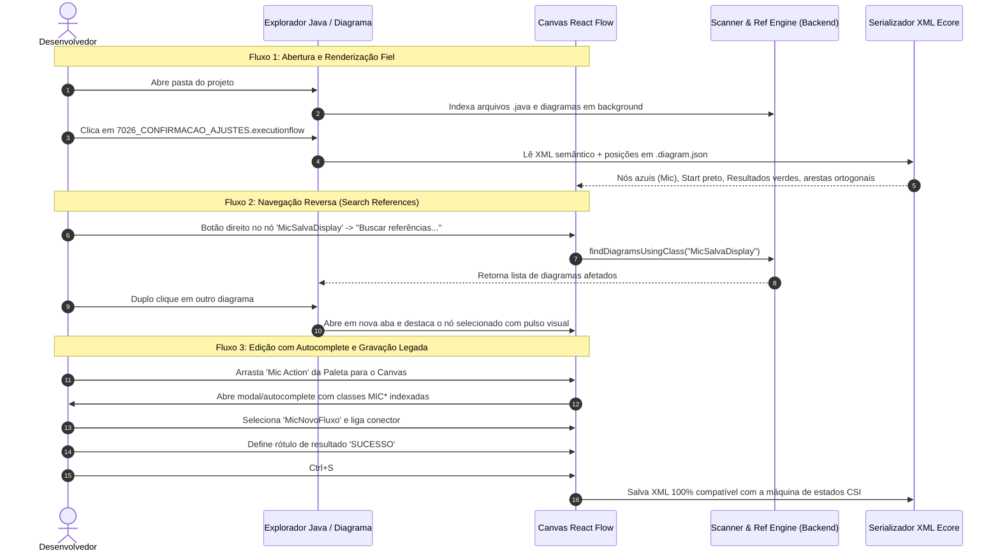
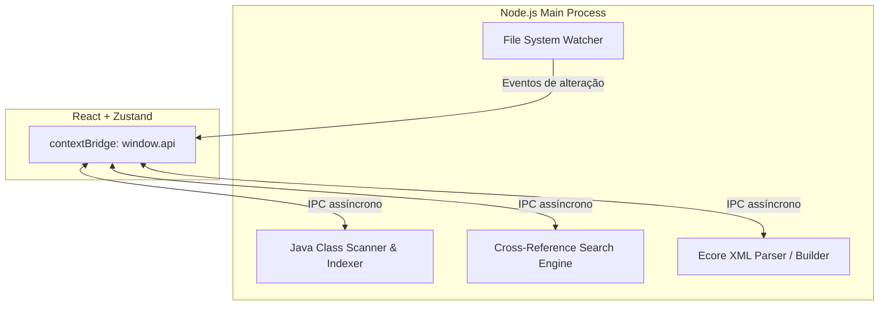

# CSI StateFlow & ExecutionFlow Studio - Especificação Técnica e Plano Integrado

> **Equipe Envolvida**: UX Architect, Senior Frontend Specialist, Backend Architect & Code Archaeologist.  
> **Objetivo**: Ferramenta Desktop autônoma (Electron + React Flow), 100% livre do Eclipse, que replica todas as capacidades visuais e de navegação reversa do plugin original, com usabilidade moderna e geração de XML compatível com a máquina de estado legada.

---

## 🎨 1. Proposta de UX & Arquitetura de Telas (UX Specialist)

### 1.1 Layout Geral da Aplicação (Workbench de 3 Painéis)

```
+-------------------------------------------------------------------------------------------------------------+
|  [Menu: Arquivo | Editar | Exibir | Projeto | Ajuda]              Projeto: [ pdv-centauro-trunk ]  [🔍 Busca] |
+------------------------+------------------------------------------------------------------+-----------------+
| 📁 EXPLORADOR          |  📑 [7025_AJUSTES.executionflow]  📑 [7026_CONFIRMACAO.executionflow*] | 🎨 PALETA       |
| ---------------------- |------------------------------------------------------------------| ---------------+ |
| ▾ 🗂️ Diagramas         |                                                                  | [↖] Seleção     |
|   pdv/                 |    (•) Start                                                     | [•] Start Point |
|     7025_AJUSTES...    |     |                                                            | [⚙] Mic Action  |
|     7026_CONFIRMACAO.. |     | (Start Link)                                               | [🗂] Subfluxo    |
|                        |     ▼                                                            | [🏁] Resultado  |
| ▾ ☕ Classes Java (MIC) |   +-------------------+  DEFAULT  +---------------------+        | [📝] Nota       |
|   [🔍 Filtrar Mic...]   |   | ⚙ MicSalvaDisplay |-------->| ⚙ MicConfirmaAjustes|        |                 |
|   ⭐ MicAbandonaAjustes|   +-------------------+         +---------------------+        | ----------------|
|   ⭐ MicAbreGaveta     |             |                              |                     | 📋 PROPRIEDADES |
|   ⭐ MicConfirmaAjustes|             | ABANDONAR                    | NAO_HA_AJUSTES      | ---------------+ |
|   ⭐ MicSalvaDisplay   |             ▼                              ▼                     | Tipo: MicAction |
|                        |   +-------------------+         +---------------------+        | Nome:           |
|                        |   | ⚙ MicAbandonaAj...|         | ⚙ MicRecuperaDisplay|        | MicSalvaDisplay |
|                        |   +-------------------+         +---------------------+        | Pacote:         |
|                        |             |                              | DEFAULT             | com.csi.oper.pos|
|                        |             +------------------------------+                     | PathKey:        |
|                        |                                            ▼                     | 1386704906523   |
|                        |                                   (🏁 FINALIZA_AJUSTES)          |                 |
|                        |                                                                  |                 |
+------------------------+------------------------------------------------------------------+-----------------+
| 🔍 REFERÊNCIAS: 3 diagramas utilizam 'MicSalvaDisplay'  [ 7025_AJUSTES.executionflow | 7026_CONFIRMACAO... ] |
+-------------------------------------------------------------------------------------------------------------+
```

### 1.2 Fluxos de Navegação e Interação (User Journeys)



### 1.3 Princípios de Usabilidade (UX Guidelines)
* **Reconhecimento Imediato**: Cores idênticas ao Eclipse original (Azul clássico para nós executáveis, Verde para resultados, Bege para subfluxos, Amarelo para notas adesivas) eliminando curva de aprendizado.
* **Ergonomia de Diagramação**:
  * Arestas ortogonais inteligentes com cantos arredondados sutis (evita sobreposição confusa de linhas).
  * Snap-to-grid magnético e guias de alinhamento ao arrastar nós.
  * Inserção rápida: arrastar um conector para o vazio abre um menu radial/dropdown ("Conectar com: Próxima Mic, Resultado, Subfluxo").
* **Atalhos Produtivos**:
  * `Ctrl+S`: Salvar diagrama ativo.
  * `Ctrl+F`: Busca rápida dentro do diagrama aberto.
  * `Ctrl+Shift+F`: Busca global de classes em todos os diagramas.
  * `Espaço + Arrastar` ou `Botão do Meio`: Pan fluído pelo canvas.
  * `Scroll`: Zoom in / Zoom out centrado no cursor.
  * `Delete` ou `Backspace`: Exclusão com confirmação e remoção limpa de arestas conectadas.

---

## ⚡ 2. Arquitetura do Frontend (Senior Frontend Specialist)

### 2.1 Stack & Componentes
* **Engine Visual**: `@xyflow/react` (React Flow v12) com virtualização de nós para suportar fluxos complexos de mais de 100 nós sem queda de FPS.
* **Gerenciador de Estado**: `Zustand` (desacoplado do ciclo de re-render do React, garantindo atualizações instantâneas do diagrama e gerenciamento de abas).
* **Nós Customizados**:
  1. `StartPointNode`: Círculo preto SVG com porta de saída (`source`).
  2. `ExecutableNode`: Card azul suave (`bg-[#EAF1FB]`, `border-[#6C8EBF]`), ícone SVG de engrenagem, título em negrito (`Mic...`) e pacote como subtexto.
  3. `SubflowNode`: Card bege/dourado (`bg-[#FFF2CC]`, `border-[#D6B656]`), ícone de diagrama, indicando referência a outro arquivo.
  4. `ResultNode`: Pílula verde suave (`bg-[#E2F0D9]`, `border-[#70AD47]`), ícone de bandeira verde e rótulo em caixa alta.
  5. `StickyNoteNode`: Card estilo post-it amarelo (`bg-[#FFF9C4]`, `border-[#FBC02D]`), com textarea editável e alça de redimensionamento.
* **Arestas Customizadas (`StepEdge` / `OrthogonalEdge`)**:
  * Conexões em 90° com badge centralizado exibindo o rótulo da condição (`DEFAULT`, `ABANDONAR_AJUSTES`, `NAO_HA_AJUSTES`).
  * Clique no badge permite edição imediata do texto da transição.

---

## 🛡️ 3. Arquitetura do Backend & IPC (Backend Architect)

### 3.1 Serviços do Processo Principal (Electron / Node.js)



1. **Scanner de Classes Java (`javaScanner.ts`)**:
   * Varre a pasta de fontes selecionada via streams assíncronas do Node.js.
   * Utiliza regex compilada de alta performance para extrair declarações de classes sem overhead de JVM:
     `package\s+([\w\.]+);` e `public\s+(?:class|abstract\s+class)\s+(Mic\w+)`
   * Indexa 5.000 classes em menos de 200ms.
2. **Motor de Busca Cruzada (`referenceEngine.ts`)**:
   * Mantém um grafo em memória: `Map<NomeClasse, Set<CaminhoDiagrama>>`.
   * Quando o usuário pesquisa uma classe, a resposta é instantânea (O(1)).
3. **Serializador Ecore Bidirecional (`xmlEngine.ts`)**:
   * **Geração do XML Semântico**: Produz XML idêntico ao modelo Ecore original:
     ```xml
     <?xml version="1.0" encoding="UTF-8"?>
     <com.csi.gmf.executionflow:ExecutionFlow 
         xmi:version="2.0" 
         xmlns:xmi="http://www.omg.org/XMI" 
         xmlns:com.csi.gmf.executionflow="http:///com/csi/gmf/executionflow.ecore" 
         id="7026" title="7026_CONFIRMACAO_AJUSTES">
       <executableFlowObjects pathKey="1386704906523" className="com.csi.oper.pos.MicSalvaDisplay" simpleClassName="MicSalvaDisplay"/>
       ...
       <flowConnections sourcePathKey="1386704906523" destinationPathKey="1386704906524" executionFlowResultValue="DEFAULT"/>
     </com.csi.gmf.executionflow:ExecutionFlow>
     ```
   * **Arquivo de Layout Espelhado (`.diagram.json`)**: Armazena as posições (x, y), notas adesivas e viewport do canvas sem poluir o XML consumido pelo motor de execução em Java.

---

## 🚀 4. Plano de Tarefas Detalhado e Faseado

### Fase 1: Fundação & Scaffolding (Electron + Vite + React + Tailwind)
- [ ] Inicializar projeto com Vite (React + TypeScript + Tailwind CSS).
- [ ] Configurar runtime Electron com `electron-builder` para Windows.
- [ ] Criar `preload.ts` seguro expondo API tipada (`window.api`).
- [ ] **Critério de Aceite**: `npm run dev` abre janela desktop integrada e responsiva.

### Fase 2: Motor XML Ecore & Testes Unitários de Compatibilidade
- [ ] Implementar `xmlEngine.ts` para parsear e serializar `.executionflow` e `.stateflow`.
- [ ] Implementar geração de `pathKey` único (timestamp epoch em ms).
- [ ] Criar fixture de teste com o XML de `7026_CONFIRMACAO_AJUSTES`.
- [ ] **Critério de Aceite**: Teste automatizado de round-trip (XML original -> Objeto TypeScript -> Novo XML) com equivalência semântica 100%.

### Fase 3: Scanner Java & Busca Cruzada de Referências
- [ ] Implementar leitor assíncrono de pastas Java com foco em classes `Mic*`.
- [ ] Implementar motor de indexação reversa (classe -> diagramas).
- [ ] Conectar canal IPC de busca em tempo real.
- [ ] **Critério de Aceite**: Selecionar pasta do projeto e pesquisar `MicSalvaDisplay`, retornando todos os diagramas correspondentes em milissegundos.

### Fase 4: Canvas Visual de Diagramação (React Flow)
- [ ] Desenvolver nós personalizados com fidelidade visual aos prints originais:
  - `StartPointNode` (círculo preto + conector tracejado).
  - `ExecutableNode` (caixa azul + ícone engrenagem + badge de classe).
  - `SubflowNode` (caixa amarela/bege + ícone de fluxo).
  - `ResultNode` (pílula verde + bandeira verde).
  - `StickyNoteNode` (post-it amarelo redimensionável para anotações).
- [ ] Implementar arestas ortogonais em 90° com badges de texto clicáveis (`DEFAULT`, etc.).
- [ ] Configurar minimapa, controles de zoom e snap-to-grid magnético.
- [ ] **Critério de Aceite**: Abrir o arquivo de exemplo e exibir o diagrama visualmente idêntico à captura de tela do Eclipse.

### Fase 5: Workbench, Menus de Contexto & Inspetor de Propriedades
- [ ] Painel lateral esquerdo com Explorador de Diagramas e Árvore de Classes Java.
- [ ] Paleta retrátil com ferramentas de inserção de nós e conexões.
- [ ] Menu de contexto nos nós (`Buscar referências`, `Adicionar Nota`, `Excluir`, `Propriedades`).
- [ ] Painel inferior de referências cruzadas com navegação por duplo clique.
- [ ] Painel de propriedades para edição de `Class Name`, `Simple Class Name`, `Path Key` e `Description`.
- [ ] **Critério de Aceite**: Usuário pode editar propriedades de nós, ligar conexões e buscar referências sem sair da interface.

### Fase 6: Validação Integrada & Build Windows
- [ ] Testar fluxo completo de ponta a ponta: criar novo fluxo, adicionar classes `Mic*` do projeto, conectar resultados, salvar XML e reabrir.
- [ ] Configurar empacotamento com `electron-builder` para gerar executável portátil `.exe` para Windows.
- [ ] **Critério de Aceite**: Executável `.exe` gerado rodando de forma independente em qualquer máquina Windows sem necessidade de Java, Node ou Eclipse instalados.
